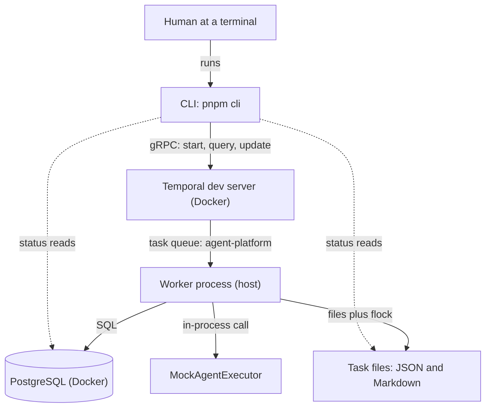
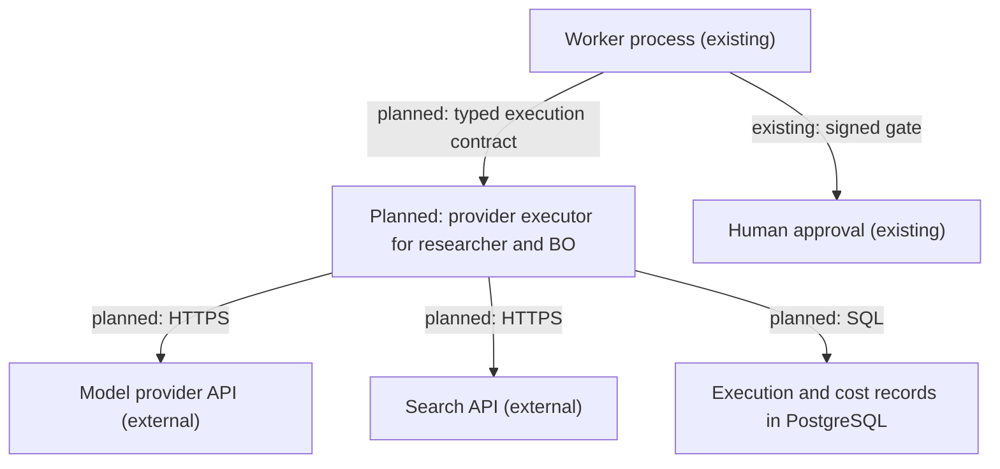

# Architecture overview

Reviewed commit: `71dcfbc2a08ecd5e6e665ab88b3a2e552afc684e` (see [validation report](../validation-report.md) for what was checked and how).

## In plain English

This repository is a small, local-first engine that runs a **research → business-owner evaluation → human approval**
workflow on one machine. A command-line tool starts a run. A worker process executes it step by step under
[Temporal](https://docs.temporal.io/), which remembers where every run is and retries failed steps. The two "agents" are
**deterministic mocks** that return clearly fictional text; no model, search API or paid service is contacted. After the mock
evaluation the run **stops and waits** until a person approves or rejects it with a signed command. Nothing is built or
deployed after approval.

The value of the current code is the foundation around the agents: durable orchestration, a safe approval gate, recorded
executions that are not blindly repeated, and a local task file store. Real agents are planned (roadmap step 4) and are not
implemented.

## Implemented and planned

| Capability                                                                 | Status                          | Where                                                                          |
| -------------------------------------------------------------------------- | ------------------------------- | ------------------------------------------------------------------------------ |
| CLI: start, status, approve, reject, keygen, executions, reconcile, doctor | Implemented                     | [`apps/cli`](../../apps/cli/src/cli.ts)                                        |
| Temporal workflow `researchProposalWorkflow` with Activities               | Implemented (mock agents)       | [`apps/worker`](../../apps/worker/src/workflows/index.ts)                      |
| Mock researcher and business-owner executor                                | Implemented (mock)              | [`executors.ts`](../../packages/integrations/src/executors.ts)                 |
| Signed human approval gate (Temporal Update, Ed25519 envelope)             | Implemented                     | [security](security.md), [workflows](workflows.md)                             |
| Durable execution records, leases, uncertain-outcome handling              | Implemented                     | [`agent-stage.ts`](../../apps/worker/src/agent-stage.ts)                       |
| PostgreSQL business records, migrations                                    | Implemented                     | [`packages/persistence`](../../packages/persistence/src/index.ts)              |
| Local task files (JSON + Markdown) with Linux `flock`                      | Implemented                     | [`local-task-store.ts`](../../packages/integrations/src/local-task-store.ts)   |
| CI, 80% line/branch coverage floor                                         | Implemented                     | [`ci.yml`](../../.github/workflows/ci.yml), [code quality](../code-quality.md) |
| Role instructions and model profiles                                       | Placeholders only, not wired    | [`packages/agents`](../../packages/agents/src/index.ts)                        |
| Real researcher and BO via direct model/search APIs                        | **Planned** (roadmap steps 2-4) | [ADR 5](../decisions/0005-direct-api-research-first.md)                        |
| Execution/cost visibility, budget enforcement, restricted tools            | **Planned** (step 3)            | [security](security.md)                                                        |
| Product repository, PM/architect roles, OpenHands, deployment, QA          | **Planned** (steps 6-9)         | [project state](../project-state.md)                                           |
| Parallel execution, Jira task adapter, cloud hosting                       | **Planned** (steps 10-12)       | [project state](../project-state.md)                                           |

## Current runtime components

One question: **what runs today, and who talks to whom?**

- **Temporal dev server** is infrastructure (a Docker container). It stores workflow history and delivers work through a
  **task queue**. It does not run application code.
- **Worker** is _our_ long-running Node process (`pnpm worker:start`). It hosts the workflow code and the Activities
  (the steps that touch the database, files and executor).
- **Executor** is a plain TypeScript object called inside the worker. Today it is the mock; no model provider is contacted.
  A model provider would be a separate external API (see the planned diagram below).
- The CLI never calls the worker directly: it talks to Temporal, which delivers work to the worker.

### Who owns which data

| Data                                                                             | Authority                                                                                  | Evidence                                                                     |
| -------------------------------------------------------------------------------- | ------------------------------------------------------------------------------------------ | ---------------------------------------------------------------------------- |
| Orchestration state, stage timeline, retries, the waiting Update                 | **Temporal history** (workflow state is read through Query `getStatus`)                    | [`workflows/index.ts`](../../apps/worker/src/workflows/index.ts)             |
| Runs, results (with content digests), review gates, approvals, executions, costs | **PostgreSQL**                                                                             | [`migrations`](../../packages/persistence/migrations/)                       |
| Local task snapshot (task + results + approvals) used by the task adapter        | **JSON file** `task-<runId>.json`, written by Activities _after_ Postgres, as a projection | [`local-task-store.ts`](../../packages/integrations/src/local-task-store.ts) |
| Human-readable view                                                              | **Markdown** `task-<runId>.md`, derived from the JSON, rebuildable                         | `LocalTaskStore.rebuildProjection`                                           |

Details verified in code: agent results and approvals are written to Postgres first (`RunRepository.completeExecution`,
`insertApproval`) and then projected to the task files (`TaskStore.attachResult`, `recordApproval`). The business-owner
stage reads the research result from Postgres, not from the file. If the two disagree, Postgres wins and the next retry
re-projects it. Temporal history holds workflow inputs (goal, constraints), Activity arguments and the signed (public)
approval envelope, but not result payloads.

## Planned initial real-agent flow (NOT implemented)

One question: **what will the first real run look like?** This is the agreed target for roadmap steps 2-4. Nothing below
exists in code yet except the Temporal, Postgres, task-file and approval parts shown in the previous diagram.

Agreed constraints: sequential stages only; roles are executed when needed (not seven always-running services); Temporal is the
only coordinator (no LangGraph, Mastra or CrewAI); budgets and tool permissions are enforced outside the model;
OpenHands, Jira, product repositories and cloud hosting are **deferred** (roadmap steps 7-12) and are not prerequisites for
research. See [ADR 5](../decisions/0005-direct-api-research-first.md) and [security](security.md).

## Where things run and what must stay running

| Piece                                       | Where                                                                                                                             | Needs to be running?                                            |
| ------------------------------------------- | --------------------------------------------------------------------------------------------------------------------------------- | --------------------------------------------------------------- |
| PostgreSQL 16.15, Temporal dev server 1.9.1 | Docker Compose ([`infra/compose.yaml`](../../infra/compose.yaml)), ports on `127.0.0.1` only (5433, 7233, UI 8233), named volumes | Yes, for any run (`pnpm infra:up`)                              |
| Worker                                      | Host process `pnpm worker:start`                                                                                                  | Yes. If it stops, runs pause and resume when it returns         |
| CLI                                         | Short-lived `pnpm cli ...` commands                                                                                               | Only while you issue a command                                  |
| Task files                                  | `TASK_STORE_DIR` (default `.task-data/tasks`, relative to the process working directory)                                          | Not a process; start the CLI and worker from the same directory |
| Approval keys                               | Outside the repository (default `~/.config/agent-platform/approval/`)                                                             | Not a process; only the public file is given to the worker      |

**CI and tests are not deployment.** GitHub Actions runs the same Compose stack to execute tests; integration tests create
temporary databases and task queues and delete them. There is no product deployment, cloud resource or hosted service. Setup
steps live in [local development](../local-development.md).

## Glossary

| Term               | Meaning here                                                                                                |
| ------------------ | ----------------------------------------------------------------------------------------------------------- |
| Workflow           | Deterministic orchestration code run by Temporal; it only decides what happens next                         |
| Activity           | A step that may touch the outside world (database, files, executor); retried by Temporal                    |
| Worker             | Our process that runs workflow code and Activities for a task queue                                         |
| Task queue         | The named inbox (`agent-platform`) through which Temporal hands work to the worker                          |
| Update / Query     | Temporal messages to a running workflow: an Update can change state and be rejected; a Query only reads     |
| Gate (review gate) | The record of exactly which results (IDs and digests) a human is asked to approve                           |
| Execution record   | The `agent_executions` row that tracks one agent run (state, lease, attempts) so it is not repeated blindly |
| Lease / fence      | A time-limited claim on an execution plus a counter that makes stale claimants unable to write              |
| Uncertain          | An execution that may have run externally but whose result was not stored; never re-run automatically       |
| Projection         | A derived copy of canonical data (the task JSON from Postgres, the Markdown from the JSON)                  |
| Trusted signer     | A public key (with an actor name) the worker accepts approvals from                                         |

Next: [workflows](workflows.md), [modules](modules.md), [security](security.md), [decisions](../decisions/README.md).
