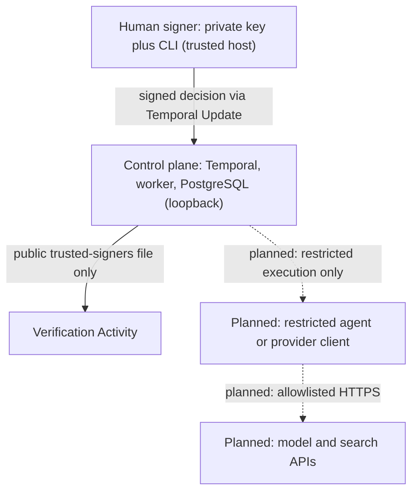

# Security and trust boundaries

This describes a **local development system running mock agents**. It is not production-ready, and it does not
guarantee exactly-once external billing. Evidence labels: **source** (read in code), **test** (a test that asserts it),
**doc** (documented intent only).

## Trust boundaries

One question: **who is trusted with what?** Solid arrows are implemented; dashed ones are planned and **not implemented**.

The planned agent side has no Temporal, PostgreSQL, private-key or host-CLI access. None of that separation exists yet.

## Enforced today

| Control                                                                                                                                                                   | Evidence                                                                                                                                 |
| ------------------------------------------------------------------------------------------------------------------------------------------------------------------------- | ---------------------------------------------------------------------------------------------------------------------------------------- |
| A human decision is accepted only as an Ed25519-signed envelope bound to run, gate, artifact digests, decision ID, key ID, actor, expiry                                  | source: `verifyApproval` in [`node.ts`](../../packages/contracts/src/node.ts); test: `approval.test.ts`, `approvals.integration.test.ts` |
| Decisions before the gate opens, for stale/other gates, with changed artifacts, expired, replayed, or from untrusted keys are rejected and never buffered                 | test: [`approvals.integration.test.ts`](../../tests/integration/approvals.integration.test.ts)                                           |
| `actor` is taken from the trusted-signers file, not from the caller                                                                                                       | source: `verifyApproval`; test: "actor that differs from the trusted signer config"                                                      |
| The business-owner mock cannot approve (`isHumanApproval: false`; the workflow accepts only verified envelopes)                                                           | source: `executors.ts`, `workflows/index.ts`                                                                                             |
| Worker refuses to start if `APPROVAL_SIGNER_FILE` (private key path) is in its environment                                                                                | source + test: `assertNoPrivateSigningKey`, `worker-env.test.ts`                                                                         |
| Key generation is an explicit command; refuses to write inside the repository or overwrite; private file mode `0600`, directory `0700`                                    | source + test: `keygen.ts`, `cli.integration.test.ts`                                                                                    |
| One logical run ID has one immutable human decision: CLI start policy `ALLOW_DUPLICATE_FAILED_ONLY`, Postgres guard `RunAlreadyDecided`, transactional `DecisionConflict` | source + test: [`run-identity.integration.test.ts`](../../tests/integration/run-identity.integration.test.ts)                            |
| Real execution never falls back to the mock; unimplemented real mode fails the stage                                                                                      | source + test: `createExecutor`, `OpenHandsAgentExecutor`, executions tests                                                              |
| Task files are redacted for secret-looking strings before writing; worker logs redact `DATABASE_URL`-style fields                                                         | source: `redactDeep` (`local-task-store.ts`), pino `redact` in `apps/worker/src/main.ts`; test: `integrations.test.ts`                   |
| Docker ports bind to `127.0.0.1` only                                                                                                                                     | source: [`infra/compose.yaml`](../../infra/compose.yaml)                                                                                 |
| Model profiles store an environment variable **name**, never a secret (schema rejects values that are not env-var names)                                                  | source + test: `modelProfileSchema`, `contracts.test.ts` (profiles are not used at runtime yet)                                          |
| Container images and GitHub Actions are pinned (no `latest`; Actions by commit SHA); CI has read-only token permissions                                                   | source: `compose.yaml`, `ci.yml`                                                                                                         |

## Trusted-host assumptions

These hold only if the machine and its OS user are trusted:

- **Signed approval authenticates a trusted key, not a human click.** Anyone or anything that can read the private signer file or run
  `pnpm cli approve` as the same OS user can approve. Same-OS-user access defeats the key isolation; the file mode only protects
  against other users. An agent process must not share the approver's user (see planned controls).
- **No authentication on Temporal and PostgreSQL.** The dev server has no auth and PostgreSQL uses the dummy development password from
  [`.env.example`](../../.env.example) / compose defaults. Any local process that can reach `127.0.0.1:7233`, `:8233` or `:5433` can
  start or inspect workflows and read or write business records. Approvals still need a valid signature, but a local attacker with
  database access could alter records directly. Do not expose these ports.
- **The Temporal UI and history show workflow inputs**: the goal text, constraints, result IDs, titles and the (public) signed envelopes.
  Result payloads stay in PostgreSQL and the task files.
- **Docker and OS users:** members of the `docker` group and root can bypass everything on this page.

## Planned before any real tool or agent execution

Documented, **not implemented** (no sandbox, container isolation or network separation exists in the code today):

- Agents run in containers/VMs as an unprivileged user with no host mounts beyond their workspace and no Docker socket.
- Separate networks or firewall rules so agent processes cannot reach Temporal, PostgreSQL or the UI, and can reach only allowlisted provider/search hosts.
- Approval keys are never mounted into worker or agent containers; the approver CLI is not installed in agent images.
- Budgets, per-role tool allowlists and timeouts are enforced by the executor/runtime, not by prompts (`ModelProfile.budget` and
  `assertProfileConfigured` exist but are unused). Prompt instructions are never a security boundary.
- Real provider usage metering and reconciliation (today only mock records with cost 0 exist), enforced runtime spending limits, and provider-side spend limits as a second line of defense. Having cost tables or a `budget` profile field does **not** mean budgets are enforced.
- An authenticated approval API or hardware-backed signing for any non-local setup.

## Credentials and data leaving the machine

- Credentials are referenced by **environment variable name** only (`.env.example` lists names with empty values; real values go in the
  git-ignored `.env`). Mock mode needs none. Do not put `APPROVAL_SIGNER_FILE` in the shared `.env`.
- With future cloud model/search APIs, whatever is placed in a prompt or query leaves the machine: the goal, constraints, earlier
  outputs and search terms. Do not send private business data until the provider terms and retention are reviewed. Signing keys,
  `.env`, and database contents are not sent by the current design.
- **Ignored by Git** ([`.gitignore`](../../.gitignore)): `.env` and `.env.*` (except `.env.example`), `.task-data/`, `artifacts/`, `*.db`,
  `*.sqlite`, `*.log`, `logs/`, `coverage/`, `dist/`, `node_modules/`, `*.tsbuildinfo`, `.scratch/`. Approval keys live outside the repository.

## Local file backend limits

- **Advisory lock.** `LocalTaskStore` serializes writers with Linux `flock` ([`file-lock.ts`](../../packages/integrations/src/file-lock.ts)).
  A process or editor that ignores the protocol can still modify the files. All legitimate writers must go through the store.
- **Linux and local filesystems only.** Other platforms throw `UnsupportedPlatformError`; NFS/SMB, network-synced folders and
  multi-host coordination are unsupported and untested.
- **Persistent lock inodes.** The `.locks/<taskId>.lock` files are never deleted or replaced, because unlinking could let two
  processes lock different inodes. They stay on disk (empty, mode `0600`).
- **No expiry.** A live but paused writer keeps the lock; contenders time out (default 15 s). A dead process releases it at once.
- **Publication is not one transaction.** JSON and Markdown are each written by temp-file rename; the Markdown is published after the
  JSON and can lag after a crash until the next operation or `rebuildProjection`. Nothing is fsynced, so power loss may lose recent writes.
- Readers take no lock and see a complete old or new file.

## Not claimed

Production readiness; protection against a hostile local user or same-user agent; proof of human presence; exactly-once billing with
external providers (idempotency keys help only if the provider honors them; uncertain executions are surfaced, never silently repeated);
any cloud deployment, tenant isolation or compliance posture.
