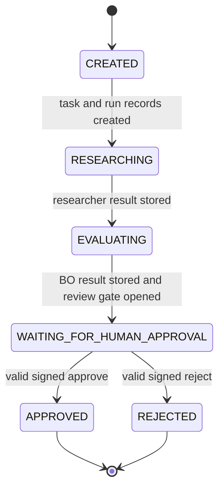
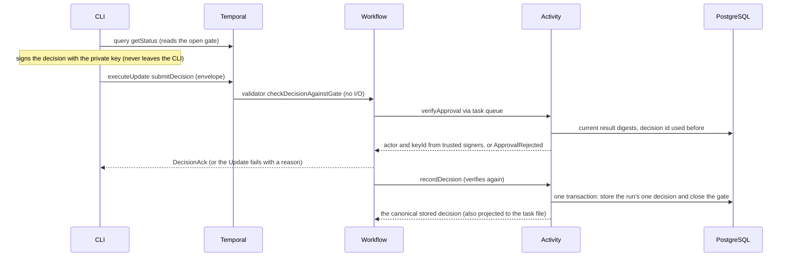

# Workflows

The only implemented workflow is `researchProposalWorkflow`
([`apps/worker/src/workflows/index.ts`](../../apps/worker/src/workflows/index.ts)). Its Activities are created by
`createActivities` in [`activities.ts`](../../apps/worker/src/activities.ts); agent stages run through `runAgentStage` in
[`agent-stage.ts`](../../apps/worker/src/agent-stage.ts). Both agents are mocks. Context: [overview](overview.md).

## Contract

| Item                            | Value                                                                                                                                                            |
| ------------------------------- | ---------------------------------------------------------------------------------------------------------------------------------------------------------------- |
| Workflow ID                     | The run ID, chosen by the client (`pnpm cli start --run-id`, default `run-<random>`). Task ID is `task-<runId>`                                                  |
| Input (`ResearchProposalInput`) | `runId`, `goal`, `constraints` (`budgetUsd`, `teamSize`, `timelineWeeks`, `notes`; each a value or the literal `'unknown'`, never guessed)                       |
| Output (`WorkflowStatus`)       | `status`, `stages[]` (timeline), `resultIds`, `gate`, `decision`; also returned by the Query                                                                     |
| Query `getStatus`               | Read-only snapshot of the output above; `gate` is present only once the review gate is open                                                                      |
| Update `submitDecision`         | Takes one signed approval envelope; validated, verified, then acknowledged with `DecisionAck`. Names: `DECISION_UPDATE`, `STATUS_QUERY` in `@platform/contracts` |
| Business statuses               | `CREATED`, `RESEARCHING`, `EVALUATING`, `WAITING_FOR_HUMAN_APPROVAL`, `APPROVED`, `REJECTED` (`STATUSES` in `records.ts`)                                        |
| Task queue                      | `TASK_QUEUE` (default `agent-platform`)                                                                                                                          |

## Implemented state machine

One question: **which business statuses can a run have, and what moves it?**



- Statuses only move forward; `APPROVED` and `REJECTED` are terminal (the same order is enforced in
  `RunRepository.updateStatus` and `LocalTaskStore.changeStatus`).
- The business owner's evaluation (`isHumanApproval: false`) is a recommendation. It cannot advance the run.
- The run reaches `WAITING_FOR_HUMAN_APPROVAL` only inside the `openReviewGate` Activity, after both results are stored in
  Postgres and projected to the task file. The gate becomes visible in the Query only after that Activity returns.
- **There is no `FAILED` business status.** A run that fails is a Temporal "Failed" workflow; the database and task file keep
  the last stage that was projected (for example `RESEARCHING`). See [failure behavior](#failure-behavior).
- Nothing happens after approval or rejection: no product repository, deployment or follow-up workflow exists.

## Approval verification

One question: **how does a signed decision get from the terminal to a stored approval?** (Participants are code, not services:
"Workflow" and "Activity" both run in the worker process; Temporal delivers each via the task queue.)



Rules, with the code that implements them:

- **Before the gate is open** the validator rejects every decision ("review gate is not open yet"); nothing is buffered.
  `checkDecisionAgainstGate` in [`approval.ts`](../../packages/contracts/src/approval.ts) is the pure check shared by the validator and
  the re-check after verification.
- The envelope is bound to the run, the gate ID and the exact artifact IDs and SHA-256 digests. A decision for older results is
  rejected, also if Postgres results changed after the gate opened (`currentArtifacts` in `activities.ts`).
- `verifyApproval` loads the **public** trusted-signers file, checks signature, signer identity, scope, validity window (max 15 min)
  and replay (`decisionId` already stored). The signer's actor name comes from that file, not from the caller.
- The first valid decision wins; the workflow re-checks after the asynchronous verification, so two concurrent decisions cannot
  both be accepted. Later decisions fail with "already accepted" or, after completion, are rejected by Temporal.
- `recordDecision` verifies again, then stores the decision **and** closes the gate in one Postgres transaction serialized per run by a
  row lock (`RunRepository.recordDecision`). It returns the canonical stored approval; the Activity projects exactly that to the task
  file, and the workflow derives its final status and `decision` from that returned value, not from the submitted envelope.
- **What the Update acknowledgment means:** `DecisionAck` says the decision was verified and accepted _for processing_. It is not a
  guarantee of durable completion: persistence happens afterwards in `recordDecision`. If that fails (for example `DecisionConflict`), the
  workflow fails explicitly and the CLI prints an error; a run never ends successfully with a decision different from the stored one.
- Trust limits are in [security](security.md).

## One immutable decision per logical run ID

The run ID is the logical identity of a request; Postgres rows are keyed by it, not by Temporal's per-execution run ID. **One run ID
has exactly one human decision, and an approved or rejected run ID is never reused.** Three independent layers enforce this:

| Layer                    | Behavior                                                                                                                                                                                                                                                                                                                                                               | Code                                                                                                              |
| ------------------------ | ---------------------------------------------------------------------------------------------------------------------------------------------------------------------------------------------------------------------------------------------------------------------------------------------------------------------------------------------------------------------- | ----------------------------------------------------------------------------------------------------------------- |
| 1. Temporal start policy | `pnpm cli start` sets `WorkflowIdReusePolicy.ALLOW_DUPLICATE_FAILED_ONLY` and `WorkflowIdConflictPolicy.FAIL`. A running or successfully completed run is **not** restarted: the CLI exits 1 with "inspect it with `status`, or choose a new `--run-id`". Failed, cancelled or terminated runs may restart                                                             | [`start.ts`](../../apps/cli/src/commands/start.ts)                                                                |
| 2. Postgres guard        | `createTaskAndRun` and `openReviewGate` first call `assertRunNotDecided`. If Postgres holds a human decision or a terminal status for the run ID, the Activity fails non-retryably with `RunAlreadyDecided`: nothing is reset, reopened, re-executed or re-projected. This holds for direct Temporal starts that bypass the CLI and after Temporal history has expired | `assertRunNotDecided` in [`activities.ts`](../../apps/worker/src/activities.ts), `RunRepository.getDecisionState` |
| 3. Canonical persistence | A different decision, envelope or decision ID for a decided run, or a decision ID used by another run, fails non-retryably with `DecisionConflict`. An identical decision is an idempotent retry                                                                                                                                                                       | `RunRepository.recordDecision`, `DecisionConflictError`                                                           |

Consequences for operators:

- **New evaluation = new run ID.** To re-evaluate something, start a new run with a new `--run-id`. There is no reversal, second approval or history deletion.
- **Recovery with the same ID** is possible only while the run is **failed and undecided** (for example after an uncertain execution and a
  `reconcile`): succeeded stages are reused and nothing is executed twice.
- If a run's decision was stored but its workflow failed before the final status was projected, the run ID is already decided and cannot be restarted;
  the stored decision stays authoritative (inspect it with `status`; this case is not expected in normal operation).

## Retry, reuse and uncertain execution

Each agent stage has one row in `agent_executions` keyed by `runId:role:stage`. What happens when something goes wrong:

| Situation                                                                                                                                                            | Result                                                                                                                       | Operator action                                                                           |
| -------------------------------------------------------------------------------------------------------------------------------------------------------------------- | ---------------------------------------------------------------------------------------------------------------------------- | ----------------------------------------------------------------------------------------- |
| Activity fails transiently (database down, projection error)                                                                                                         | Temporal **retries** (max 5 attempts, 1 s to 30 s backoff, 1-minute timeout per attempt)                                     | None                                                                                      |
| Stage already succeeded (Activity retry, or a failed undecided run restarted with the same run ID)                                                                   | **Reuse**: stored result is re-projected to the task file and cost ledger; the executor is **not** called                    | None                                                                                      |
| Another attempt holds the lease                                                                                                                                      | Retryable `ExecutionInProgress`                                                                                              | None                                                                                      |
| Result could not be stored after the executor returned (3 tries), executor error after it may have started, invalid executor output, or an invoked attempt abandoned | Execution becomes **`uncertain`**; the Activity fails with non-retryable `ExecutionOutcomeUncertain`; the **workflow fails** | See below                                                                                 |
| Executor says it never started (`ExecutorNotStartedError`)                                                                                                           | Execution returns to `pending` (attempt not counted); non-retryable `ExecutorNotStarted`; the workflow fails                 | Fix the cause, start the run again with the same ID (allowed: it failed and is undecided) |
| Same stage, different input                                                                                                                                          | Non-retryable `ExecutionInputMismatch`                                                                                       | Use a new run                                                                             |

Uncertain execution, step by step:

1. `pnpm cli executions <runId>` lists each execution with `state=`, `attempts=`, `cost=` and the stored reason.
2. Decide out of band whether an external run happened or may be repeated. Postgres cannot know; exactly-once billing is not guaranteed.
3. `pnpm cli reconcile <runId> <researcher|business-owner> --confirm-no-external-run` resets that execution to `pending`
   (previous attempts stay counted).
4. `pnpm cli start --goal "..." --run-id <same runId>`: only a failed, undecided run ID can be reused (see above); existing task, results and
   succeeded executions are reused, only the reset stage runs again.

The executor receives a stable idempotency key (`runId:role:stage:` plus the first 16 hex characters of the input digest). It prevents duplicate external work only if the provider or runtime honors it; Postgres alone cannot guarantee exactly-once billing. An `uncertain` execution is never re-run automatically. This path is covered by integration tests with a counting executor and
real Temporal retries ([`executions.integration.test.ts`](../../tests/integration/executions.integration.test.ts)).

### Failure behavior

- A failed workflow leaves `runs.status` and the task file at the last projected stage and shows as a Temporal failure (Temporal UI,
  `workflow:` line of `pnpm cli status`). Whether `status` can still answer the Query for a failed run is not covered by a test.
- A rejected decision does not fail the workflow; only the Update fails and the CLI prints `decision NOT accepted: <reason>` and exits 1.
- `EXECUTION_MODE=openhands` starts the worker with a warning; the first agent Activity then fails with non-retryable
  `ExecutorNotStarted` (real execution is not implemented) and the workflow fails. It never falls back to the mock.
- If the worker is stopped, runs wait; Updates submitted meanwhile are processed after the worker returns (integration test
  "waiting and decision processing survive a worker restart").

## What the CLI shows

`pnpm cli status <runId>` prints, from [`status.ts`](../../apps/cli/src/commands/status.ts): the Temporal workflow state, `status:`,
the stage timeline, task ID and file path, each stored result, the open `gate:`, the final `decision:` with the signer key,
the Postgres summary (status, result and approval counts, cost) and a Temporal UI link. `approve` and `reject` print one of:
`not ready` (gate closed), `decision NOT accepted: <reason>`, `run already decided` (no change), or `final status: APPROVED|REJECTED`.

## Mock example

Prerequisites (Docker stack, migrations, worker, one-time `approval-keygen` and `APPROVAL_TRUSTED_SIGNERS_FILE`): see
[local development](../local-development.md). The worker must be running and must have been started after the trusted-signers
path was set.

```sh
pnpm cli start --goal "Find a small B2C product idea" --run-id run-demo-1 --budget-usd 500
pnpm cli status run-demo-1                    # waits at WAITING_FOR_HUMAN_APPROVAL; shows both mock results and the gate
cat .task-data/tasks/task-run-demo-1.md       # human-readable projection (JSON is task-run-demo-1.json)
pnpm cli approve run-demo-1 --reason "demo"   # or: pnpm cli reject run-demo-1 --reason "demo"
pnpm cli status run-demo-1                    # APPROVED (or REJECTED) with the decision and signer
pnpm cli executions run-demo-1                # two executions, attempts=1, cost 0
```

Results are fictional placeholders (`fictionalExample: true`). The Temporal UI link printed by `start` shows the history.

## Restart, replay and old histories

- **Worker restart:** safe. The workflow resumes from Temporal history; this is exercised by the smoke script and by integration
  tests (a run stays queryable and a pending decision is processed after the worker returns).
- **Workflow code changes:** Temporal replays history against the current code, so a change that alters the order of workflow
  commands breaks open workflows, and also Queries on closed ones (`pnpm cli status` replays the history). The unsigned-Signal approval was
  replaced by the signed Update, so runs started before that change are **not** replay-compatible; new runs (new run IDs) are required and
  old histories are never deleted.
- **The canonical-decision change** (final status taken from the stored approval) is guarded with `patched('canonical-stored-decision')`
  in `workflows/index.ts`, so histories recorded before it, whose `recordDecision` returned `{ stored }`, still replay. Evidence: replaying
  all 125 completed `researchProposalWorkflow` histories in the local dev server against the new workflow code succeeded for 118; the 7 failures are
  exactly the runs started before the signed-Update change (the first run and the first smoke runs, 2026-10-30 10:44-11:08). This
  was a one-off local check, not a CI test. [`run-identity.integration.test.ts`](../../tests/integration/run-identity.integration.test.ts)
  adds a permanent replay test of a freshly recorded history. Cross-commit replay of every future change is not automated.
- Activity code (executor, database, files) can change without replay concerns, but must keep Activity names and argument shapes
  that open workflows already scheduled. The `patched()` marker can be removed only after no history without it can still be replayed.
